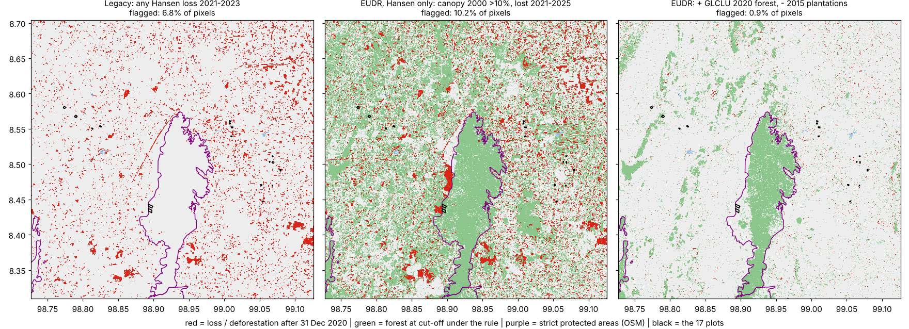

# SysEarth EUDR cube: compact plot-compliance encoding

**Question.** Can multiple geospatial layers across time and space be encoded compactly and
queried quickly, while preserving every plot-level compliance decision?

**Answer, on a 44 × 44 km clip of Surat Thani, Thailand (2.52 M pixels at 30 m):**

| | Original layers (COG) | SysEarth cube | Single-regime decision byte |
|---|---|---|---|
| Storage (needed layers) | 4.64 MB, 6 rasters + 2 vector files | **1.28 MB** (1.23 MB raster + 42 KB vectors), **3.6× smaller** | **0.28 MB, 16.5× smaller** |
| Uncompressed | 17.6 MB | 5.0 MB | 2.5 MB |
| Decision fidelity, 1,005 plots × 4 regimes (`c2`, `d1`, `d2` all match) | reference | **100 %** | 100 % (EUDR only) |
| Pixel fidelity | reference | 100 % on every field used in decisions; canopy % mean abs. error 10.3 pts | EUDR flags only |
| HTTP query, 17 plots, 40 ms latency | 51 requests, 1.21 MB, **72 ms / plot** | 10 requests, 0.36 MB, **19 ms / plot** (3.8×) | – |
| Regimes answerable | one script per regime | any cut-off year, canopy ∈ {0,10,15,20,25,30,50} %, baseline / height / plantation on or off | EUDR only |

Reproduce with:

```bash
python scripts/fetch_layers.py                 # ancillary layers (GLAD GCS, ESA S3, Overture S3)
python scripts/build_cube.py                   # -> data/cube/
python scripts/make_synthetic_plots.py --pa data/layers/protected_areas_overture.geojson \
       tests/data/synthetic_restricted_areas.geojson --n-pa 250
python scripts/evaluate.py --plots tests/data/17plots-valid.geojson tests/data/synthetic_plots.geojson
python scripts/bench_http.py --plots tests/data/17plots-valid.geojson --latency-ms 40
python scripts/plot_rules.py
```

Dependencies: `rasterio shapely pyproj numpy matplotlib` (plus `pyarrow` for the fetch script).

---

## 1. Layer analysis

See [01_layer_analysis.md](01_layer_analysis.md). In short:

- Only `c2`, `d1` and `d2` of the 35 report columns are spatial.
- **Kept:** loss year (lossless), plus canopy-in-2000 reduced to the thresholds in use.
- **Merged:** the 2020 forest baseline, height ≥ 5 m and the pre-cut-off plantation mask each become one bit.
- **Kept as exact vectors:** protected and restricted areas, with a conservative raster bit as an index.
- **Dropped:** `gain`, `first`/`last`, and the values of `datamask` beyond one bit.

The existing CSV `c2` column cannot be reproduced from any Hansen rule and is probably mocked, so fidelity is measured against the original layers.



## 2. Encoding strategy

### 2.1 Collapse time first

Hansen's 25 annual loss maps are already one band, because a pixel's first stand-replacing loss can
only happen once. The time axis therefore reduces to **one 5-bit loss year**. Every other layer is a
**state at a date** (2000 canopy, 2020 forest, 2015 plantations, current PAs). Each regime question
has the same shape:

> *was the pixel forest at the cut-off (state + no loss before it), and was it lost after?*

So the cube stores the minimum needed to evaluate that shape for any parameter set.

### 2.2 Bit layout: one uint16 per 30 m pixel (`eudr/encoding.py`)

| Bits | Field | Source | Fidelity |
|---|---|---|---|
| 0–4 | loss year 0–25 (2001–2025) | Hansen `lossyear` | lossless |
| 5–7 | canopy class, edges 0/10/15/20/25/30/50/100 | Hansen `treecover2000` | `canopy > T` exact for T ∈ {0,10,15,20,25,30,50} |
| 8 | forest 2020 (tree cover ≥ 5 m) | GLAD GLCLU 2020 (JRC GFC2020 drops in) | lossless |
| 9 | tree height ≥ 5 m | GLAD TCH 2020 | lossless |
| 10 | tree-crop plantation, **pre cut-off** | GLAD Commodities 2015 | lossless |
| 11 | strict PA, burned *all-touched* | OSM / Overture (WDPA drops in) | superset, never misses |
| 12 | restricted-use area, *all-touched* | synthetic here | superset, never misses |
| 13 | not land | Hansen `datamask` | lossless |
| 14–15 | spare (e.g. post-2025 GLAD/DIST alert flag) | – | – |

Stored as a single-band, 256 × 256 tiled, deflate Cloud-Optimized GeoTIFF on the Hansen grid.
Zstd saves another 3 %, and two uint8 bands save 12 %. Deflate was kept for compatibility.

### 2.3 Rules are parameters, not data (`eudr/rules.py`)

```python
EUDR  = Rule(cutoff_year=2020, canopy_threshold=10, use_baseline=True, exclude_plantation=True)
RSPO  = replace(EUDR, cutoff_year=2005, canopy_threshold=30, use_baseline=False, exclude_plantation=False)
LEGACY = Rule(loss_end_year=2023, require_forest=False, ...)   # "any Hansen loss 2021-2023"
```

A pixel is forest at the cut-off when all of these hold:

- its canopy class is above the threshold;
- its loss year is 0 or later than the cut-off;
- it is land;
- the optional conditions hold: in the baseline, at least 5 m tall, not plantation.

It is deforested when it is forest at the cut-off and lost after it, up to `loss_end_year`.

A plot gets a `c2` indication when at least `min_px` of its pixels are deforested.

**Ancillary layers must not post-date the cut-off they are used for.** A 2024 plantation map would
remove forest converted to palm in 2022 from the forest mask, which hides exactly the EUDR violation.
For that reason the RSPO-2005 regime switches off the 2020 baseline and the 2015 plantation mask
instead of reusing them.

### 2.4 Polygon to pixels (one rule for both paths)

- **Which pixels belong to a plot:** those whose pixel centre falls inside the polygon (GDAL default). A plot too small to contain any centre (< ~0.08 ha) falls back to every pixel it touches, so it is never empty. `pixel_rule="all_touched"` is available as a stricter option.
- **Protected-area overlap:** the plot's touched pixels are tested against the PA bit. A PA bit burned all-touched can only over-cover, so **a miss in the raster is a guaranteed miss**. A hit is confirmed with an exact polygon intersection against the vectors shipped with the cube (42 KB).

### 2.5 Query acceleration and its extra storage

| Structure | Extra storage | What it buys |
|---|---|---|
| Single band instead of 5–6 rasters | –72 % | 1 range request per plot instead of 5–6 (one per layer) |
| 16 × 16 block overview: OR of flags, max of loss year and canopy class | **+0.5 %** (6.5 KB) | Answers "no indication, no PA" without the full-resolution read, when a plot's blocks have no possible hit |
| PA vectors (exact) | +3.4 % | Exact `d1`/`d2` with the raster bit as a spatial index |
| Decision byte (optional, one regime) | +19 % if kept beside the cube, or a 16.5× smaller replacement | Fastest single-regime path |

In this plantation landscape (46 % of pixels lost at some point, 74 % plantation) the overview
resolves only 2 % of plots, because almost every 480 m block holds some post-2020 loss. In intact-forest or
cropland regions the share is far higher. The overview costs 0.5 %, so it is kept.

## 3. Prototype

| File | Role |
|---|---|
| `eudr/encoding.py` | bit layout, `encode`, field accessors, decision byte, block overview |
| `eudr/rules.py` | `Rule` dataclass; regimes EUDR, EUDR-Hansen-only, legacy, RSPO |
| `eudr/query.py` | `OriginalLayers` (raw rasters + exact vectors), `CubeLayers` (cube + overview + vector refinement), shared `plot_mask` |
| `eudr/config.json` | layer paths and class codes |
| `scripts/build_cube.py` | builds `data/cube/{cube,overview,decision_eudr}.tif` and PA vectors (≈2 s) |
| `scripts/evaluate.py` | storage, decisions, pixel fidelity, query counters → `data/cube/evaluation.json` |
| `scripts/bench_http.py` | serves files over HTTP with injected latency, counts real range requests via GDAL `/vsicurl/` |
| `scripts/make_synthetic_plots.py` | random, post-2020-loss and PA-boundary plots |
| `scripts/fetch_layers.py` | reproducible acquisition and clipping of ancillary layers ([PROVENANCE](../data/layers/PROVENANCE.md)) |

## 4. Evaluation

**Test set.** 1,005 plots:

| Plots | Kind |
|---|---|
| 17 | real |
| 600 | random |
| 138 | centred on post-2020 loss |
| 250 | on the boundaries of protected and restricted areas |

So every output has positives. Under EUDR: `c2` 238, `d1` 101, `d2` 178.

### 4.1 Storage

| Item | Bytes | Bytes / pixel |
|---|---|---|
| Hansen lossyear + treecover2000 + datamask | 2,016,468 | 0.80 |
| GLCLU 2020 + TCH 2020 + Commodities 2015 | 2,585,306 | 1.03 |
| PA vectors | 41,883 | – |
| **Original, needed** | **4,643,657** | **1.84** |
| Original, plus dropped `gain` | 4,785,415 | 1.90 |
| **Cube + overview + vectors** | **1,281,715** | **0.51** |
| Decision byte + vectors | 280,757 | 0.11 |

Reductions:

- **Cube:** 3.6× against the needed original layers, and 13.8× uncompressed to compressed (17.6 MB to 1.28 MB).
- **Decision byte:** 16.5×.

Going further is entropy-bound. The loss year alone is 3.1 bits per pixel in this rotation landscape.
Collapsing pre-2020 loss into the epochs that bound the supported cut-offs (≤ 2005, 2006–08,
2009–14, 2015–20) gives identical decisions pixel for pixel, but saves only another 10 %.

### 4.2 Query speed

**Local disk, median per plot, 1,005 plots:**

| Regime | Original layers | Cube |
|---|---|---|
| EUDR | 1.16 ms | 1.04 ms |
| Legacy | 0.94 ms | 0.83 ms |

On local disk both paths are bound by polygon rasterisation, not I/O.

**COG tile requests across the 1,005 plots:**

| Regime | Original layers | Cube |
|---|---|---|
| EUDR | 5,490 (5 files) | **1,098** |
| Legacy | 2,196 (2 files) | 1,098 |

**Object storage (HTTP range requests through GDAL `/vsicurl/`, 40 ms injected latency), EUDR:**

| Workload | Original layers | Cube | Speed-up |
|---|---|---|---|
| 17 plots, cold | 51 requests, 1.21 MB, 2.23 s | 10 requests, 0.36 MB, 0.45 s | 5.0× |
| 1,005-plot batch (tiles cached across plots) | 149 requests, 3.8 MB, 7.2 s | 40 requests, 1.29 MB, 2.9 s | 2.5× |

### 4.3 Decision fidelity

| Regime | Plots | All of `c2`, `d1`, `d2` match | Deforested pixel count matches | Positives `c2` / `d1` / `d2` |
|---|---|---|---|---|
| EUDR (baseline + plantation mask) | 1,005 | **100 %** | 100 % | 238 / 101 / 178 |
| EUDR, Hansen only | 1,005 | **100 %** | 100 % | 548 / 101 / 178 |
| Legacy (any loss 2021–23) | 1,005 | **100 %** | 100 % | 407 / 101 / 178 |
| RSPO-style 2005, canopy > 30 % | 1,005 | **100 %** | 100 % | 833 / 101 / 178 |
| Same, answered from the overview where possible | 1,005 | **100 %** | 100 % | – |

Fidelity is 100 % by construction:

- every field used by a rule is stored losslessly, or at exact threshold boundaries;
- the PA raster can only over-cover, and its hits are refined on the exact vectors;
- the overview is a monotone over-approximation, so it can only skip plots that are guaranteed negative.

**Against the existing CSV (17 plots).** The CSV is a different, undocumented process, so this is not a fidelity
measure. `c2` agrees on 9 of 17 plots under EUDR and under legacy. Under EUDR, the five plots the CSV
flagged (all cleared on site) are clean. `d1` disagrees on P-0005 and P-0006, which lie inside Khlong
Phraya WS in OSM (see 01 §1.4).

### 4.4 Pixel fidelity (cube vs aligned sources, all 2.52 M pixels)

| Field | Exact |
|---|---|
| loss year | 100 % |
| canopy class, and `canopy > T` for all 7 thresholds | 100 % |
| canopy % (reconstructed from the class midpoint) | mean abs. error 10.3 pts, RMSE 13.3 pts (not used by any decision) |
| forest 2020, height ≥ 5 m, plantation, not-land | 100 % |
| strict PA bit vs pixel-centre rasterisation of the vectors | 0 pixels missed; 1.7 % extra (boundary pixels, by design) |
| restricted bit | 0 missed; 2.8 % extra |
| decision byte vs cube rule | 100 % |

Keeping exact canopy percentages would need 7 bits, which does not fit in a uint16 with the rest. If
a regime ever needs another threshold (for example 75 %), the bin edges change. That is a rebuild,
not a redesign.

## 5. Infrastructure and cost estimate

**Scaling basis.** Bytes per pixel from this clip:

- cube 0.51;
- original needed layers 1.84;
- decision byte 0.11.

This clip is a high-entropy plantation mosaic, so these are close to worst case: intact forest,
water and cropland compress much better.

### 5.1 Data volumes

Pixels are 0.00025°, about 760 m² near the equator.

| Extent | Pixels | Cube | Original needed | Decision byte |
|---|---|---|---|---|
| This clip (1,900 km²) | 2.5 M | 1.3 MB | 4.6 MB | 0.28 MB |
| Hansen tile 10N_090E (10° × 10°, land and sea) | 1.6 G | ≤ 0.8 GB | ≤ 2.9 GB | ≤ 0.18 GB |
| Thailand (513 k km²) | 0.68 G | 0.35 GB | 1.25 GB | 0.07 GB |
| Tropics, EUDR producer belt (~50 M km²) | 66 G | 34 GB | 121 GB | 7 GB |
| Global land (~149 M km²) | 160 G | 82 GB | 295 GB | 18 GB |

### 5.2 Running cost (AWS list prices, us-east-1; GCP is similar)

| Item | Original layers | Cube |
|---|---|---|
| S3 Standard storage, global land ($0.023/GB-month) | $6.8 / month | **$1.9 / month** |
| Five-year audit retention (EUDR Art. 12), one frozen version per year | 1.5 TB → $34 / month | 0.41 TB → **$9.4 / month** |
| GET requests per cold plot query ($0.0004 / 1,000) | ~3 | ~0.6 |
| 1 M plot checks: requests | ~$1.20 | **~$0.24** |
| 1 M plot checks: Lambda at 1 GB, latency-bound (72 vs 19 ms) | ~$1.20 | **~$0.32** |
| Build, global (≈1.2 Mpx/s per core → 160 Gpx ≈ 37 core-hours, spot ~$0.04 per core-hour) | – | **~$1.50** |
| Ingest: Hansen and GLAD read from GCS (public; free if compute runs in GCP, otherwise ~$0.12/GB egress on ~300 GB) | – | $0–36 |
| Annual refresh (new Hansen loss year): rewrite bits 0–4 only, same build cost | – | ~$1.50 |

**Takeaway.** At any realistic EUDR volume (tens of millions of plots per year), infrastructure cost
is small either way: a few hundred dollars a year. What the cube changes:

- **Latency.** 3.8–5× fewer round-trips per plot, which matters for interactive due-diligence tools.
- **Operations.** One versioned artefact per year instead of six sources with different grids, versions and legends.
- **Audit.** A frozen 82 GB global cube per year is a cheap, reproducible record of exactly what each decision was based on.
- **Adaptability.** New regimes need no new data, only a new `Rule`.

## 6. Limitations and next steps

1. **JRC GFC2020 and WDPA could not be downloaded** from this sandbox (egress policy). GLAD
   GLCLU 2020 and OSM via Overture stand in. Both drop into `eudr/config.json` unchanged:
   GFC2020 sets bit 8, WDPA sets bits 11–12.
2. **Restricted-use areas are synthetic.** National Reserved Forests (Thai RFD) are the obvious
   real source.
3. **Plantation map is from 2015.** Plantations established 2016–2020 are not in it. They are
   still caught, because they show Hansen loss before the cut-off, which removes them from the
   forest mask. A 2019/2020 commodity map would be cleaner.
4. **Loss ends in 2025.** GLAD/DIST alerts (UTM 47, weekly) could fill spare bits 14–15 for
   post-2025 monitoring.
5. **The `min_px = 1` default is maximally cautious.** EUDR's 0.5 ha forest minimum suggests a
   minimum-area or connectivity rule. That is a parameter change only.
